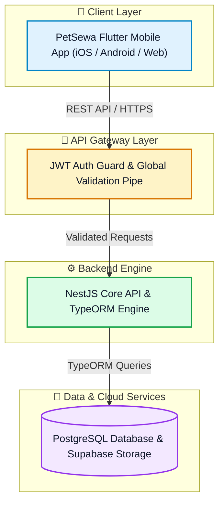

# 🐾 PetSewa India — Official GitHub Organization

**Transforming Pet Healthcare, Adoption, and Community Services across India.**

[Official Website](https://petsewa.in) • [Documentation](https://github.com/PetSewa-India/petsewa_app) • [Security Policy](https://github.com/PetSewa-India/petsewa_app/blob/main/SECURITY.md)

---

## 🌟 About PetSewa India

**PetSewa** is an all-in-one digital ecosystem designed to connect pet parents, veterinary doctors, rescue centers, foster caretakers, and animal welfare organizations across India.

---

## 🏗️ Core Technology Ecosystem

---

## 📦 Key Repositories

| Repository | Purpose | Tech Stack |
| :--- | :--- | :--- |
| [**`petsewa_app`**](https://github.com/PetSewa-India/petsewa_app) | Unified Monorepo for Backend API Engine & Cross-Platform Mobile Application | NestJS 11, TypeScript, Flutter, Supabase |

---

## 👑 Governance & Core Leadership

| Handle | Role | Team |
| :--- | :--- | :--- |
| **`@Hammaduddin561`** | Repository Admin & Lead | `Petsewa Core` |
| **`@pathakaanya12`** | Core Architect & Reviewer | `Petsewa Core` |
| **`@YantrikMinds`** | Core Admin & Operations | `Petsewa Core` |
| **`@petsewa`** | Organization Admin | `Petsewa Core` |

---

## 🔒 Security & Standards

* **0-Vulnerability Stack**: Strictly audited on modern dependencies.
* **Strict Code Reviews**: All pull requests require review and sign-off by **`Petsewa Core`**.
* **Proprietary Software**: Copyright © 2026 **PetSewa-India**. All rights reserved.

  Built with ❤️ by the PetSewa India Engineering Team

