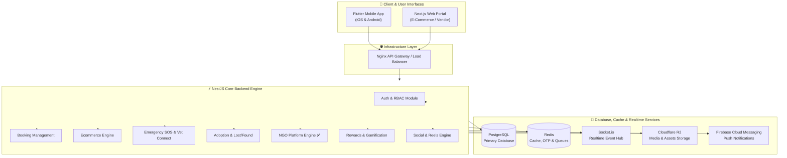
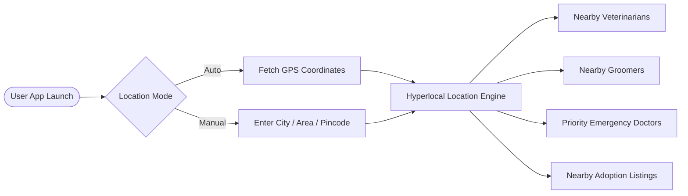
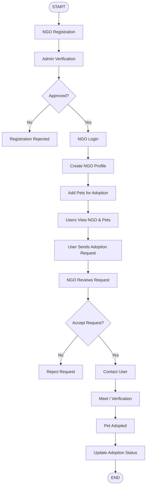

# 🐾 PetSewa — Enterprise Pet Care Ecosystem Platform

Welcome to the **PetSewa Platform** repository! PetSewa is an all-in-one hyperlocal pet care ecosystem designed to connect pet owners, service providers (veterinarians, groomers, trainers, hostels, dog walkers), pet stores, shelters, NGOs, creators, and community members under a single, unified digital platform.

---

## 📐 High-Level Architecture Overview

PetSewa utilizes an enterprise-grade modular architecture designed for high scalability, realtime operations, and future cloud infrastructure expansion (AWS migration-ready).

### System Architecture Diagram



### Hyperlocal Location & Service Flow



### NGO Platform Workflow



---

## 🚀 Key Features & Subsystems

1. **Hyperlocal Location Engine**:
   - Location-first architecture utilizing GPS coordinates, city, area, and pincode filters.
   - Distance & radius search with geo-fencing and emergency prioritization.

2. **Core Backend Modules (NestJS)**:
   - **Authentication & Security**: JWT-based auth with Refresh Tokens, Device Sessions, and Role-Based Access Control (RBAC).
   - **Booking Management Engine**: Multi-service booking system for vets, groomers, trainers, hostels, and walkers.
   - **Ecommerce Marketplace**: Multi-vendor pet product catalog, inventory tracking, cart, checkout, order tracking, and dynamic offers.
   - **Emergency Veterinary Connect System**: Instant SOS requests, emergency vet search, live chat, and automated emergency routing.
   - **Adoption & Lost/Found Portals**: Listings, pet profile management, shelter verification, lost/found location mapping, and reporting.
   - **NGO Platform Engine** ✅ *(Fully Implemented)*: End-to-end NGO registration & admin verification, pet adoption lifecycle, donation campaigns, adoption request tracking.
   - **Social & Community Platform**: User/pet profiles, posts, reels, feed recommendations, breed-specific communities, and group discussions.
   - **Rewards & Gamification Ecosystem**: Earn Pet Points, badges, user levels (Bronze to Platinum), streak rewards, and coupon redemptions.
   - **Financial & Commission Engine**: Dynamic category-based commission management, vendor wallets, withdrawal request workflows, and payout tracking.

3. **Admin & Operations Panel**:
   - Centralized management for CMS content, banners, vendor approvals, finance, moderation, SEO, analytics, and reporting.

---

## 🛠️ Technology Stack

| Layer | Technologies Used |
|---|---|
| **Mobile Applications** | [Flutter](https://flutter.dev/) (Dart) + Google Fonts |
| **Core Backend Service** | [NestJS](https://nestjs.com/) (Node.js & TypeScript) |
| **Web Platform / Vendor Portal** | [Next.js](https://nextjs.org/) (React & TypeScript) |
| **Admin & CMS Infrastructure** | [Laravel](https://laravel.com/) (PHP) / Admin CMS |
| **Realtime Messaging & Live Events** | [Socket.io](https://socket.io/), Redis Pub/Sub |
| **Database** | [PostgreSQL](https://www.postgresql.org/) (TypeORM, `synchronize: true` in dev) |
| **Caching, Queues & OTP** | [Redis](https://redis.io/) |
| **Cloud Storage** | Cloudflare R2 / AWS S3 Abstraction |
| **Deployment & Server Infrastructure**| Docker, Nginx, PM2, VPS / AWS Ready (ECS, RDS, ElastiCache) |

---

## 📁 Repository Structure

```text
petsewa-backend/
├── petsewa-backend/               # NestJS Core API Source Code
│   ├── src/
│   │   ├── modules/               # NestJS Modular Domain Architecture
│   │   │   ├── adoption/           # Pet Adoption Module
│   │   │   ├── auth/               # Authentication & JWT RBAC
│   │   │   ├── bookings/           # Service Booking Engine
│   │   │   ├── ecommerce/          # Ecommerce Marketplace Engine
│   │   │   ├── emergency/          # Emergency SOS & Vet Connect
│   │   │   ├── lostfound/          # Lost & Found Reporting Engine
│   │   │   ├── ngo/                # ✅ NGO Platform Engine (FULLY IMPLEMENTED)
│   │   │   │   ├── entities/
│   │   │   │   │   ├── campaign.entity.ts
│   │   │   │   │   ├── ngo.entity.ts          # NEW — NGO org with status lifecycle
│   │   │   │   │   ├── ngo-pet.entity.ts      # NEW — Pet listings by NGOs
│   │   │   │   │   └── adoption-request.entity.ts  # NEW — Full request tracking
│   │   │   │   ├── ngo.controller.ts          # 18 REST endpoints
│   │   │   │   ├── ngo.module.ts
│   │   │   │   └── ngo.service.ts             # 20 service methods
│   │   │   ├── rewards/            # Gamification & Rewards Engine
│   │   │   ├── social/             # Community & Reels Feed Engine
│   │   │   └── vendors/            # Vendor & Service Provider Engine
│   │   ├── app.module.ts
│   │   └── main.ts
│   ├── .env.example
│   ├── package.json
│   └── tsconfig.json
│
├── petsewa_app/                   # Flutter Mobile Application Source Code
│   ├── lib/
│   │   ├── main.dart              # App entry point — 31 named routes
│   │   ├── supabase_config.dart
│   │   ├── screens/               # 36 UI Screen Files
│   │   │   ├── [Auth Screens]
│   │   │   │   ├── splash_screen.dart
│   │   │   │   ├── onboarding_screen.dart
│   │   │   │   ├── login_screen.dart
│   │   │   │   ├── register_screen.dart
│   │   │   │   └── otp_screen.dart
│   │   │   ├── [Customer Screens]
│   │   │   │   ├── customer_home.dart
│   │   │   │   ├── profile_screen.dart
│   │   │   │   ├── create_pet_profile_screen.dart
│   │   │   │   ├── edit_pet_profile_screen.dart
│   │   │   │   ├── service_discovery_screen.dart
│   │   │   │   ├── service_details_screen.dart
│   │   │   │   ├── booking_flow_screen.dart
│   │   │   │   ├── booking_success_screen.dart
│   │   │   │   ├── my_bookings_screen.dart
│   │   │   │   ├── shop_screen.dart
│   │   │   │   ├── product_details_screen.dart
│   │   │   │   ├── cart_screen.dart
│   │   │   │   ├── adoption_screen.dart
│   │   │   │   ├── lost_found_screen.dart
│   │   │   │   ├── emergency_screen.dart
│   │   │   │   ├── wallet_screen.dart
│   │   │   │   └── notifications_screen.dart
│   │   │   ├── [Provider Screens]
│   │   │   │   ├── provider_service_select_screen.dart
│   │   │   │   ├── provider_register_screen.dart
│   │   │   │   ├── provider_verification_screen.dart
│   │   │   │   ├── provider_pending_screen.dart
│   │   │   │   └── provider_home_screen.dart
│   │   │   └── [NGO Screens] ✅ NEW
│   │   │       ├── ngo_registration_screen.dart
│   │   │       ├── ngo_pending_screen.dart
│   │   │       ├── ngo_login_screen.dart
│   │   │       ├── ngo_dashboard_screen.dart
│   │   │       ├── ngo_add_pet_screen.dart
│   │   │       ├── ngo_hub_screen.dart
│   │   │       ├── ngo_detail_screen.dart
│   │   │       ├── adoption_request_screen.dart
│   │   │       └── my_adoption_requests_screen.dart
│   │   ├── services/
│   │   │   ├── auth_service.dart
│   │   │   └── ngo_service.dart   # NEW — All NGO API calls
│   │   └── utils/
│   │       ├── app_theme.dart     # FIXED — Complete shadows, gradients, GoogleFonts
│   │       └── validators.dart
│   └── pubspec.yaml               # UPDATED — google_fonts: ^6.1.0 added
│
└── .github/workflows/
    └── ci.yml                     # GitHub Actions CI/CD Workflow
```

---

## ✅ NGO Platform — Complete API Reference

The NGO module exposes **18 REST endpoints** at `/ngo/*` covering the full platform workflow:

### NGO Registration & Auth
| Method | Endpoint | Description |
|---|---|---|
| `POST` | `/ngo/register` | Register NGO (status: pending) |
| `POST` | `/ngo/login` | NGO login — returns profile if approved |

### Admin Verification
| Method | Endpoint | Description |
|---|---|---|
| `GET` | `/ngo/admin/pending` | List all pending NGO registrations |
| `PATCH` | `/ngo/:id/approve` | Approve an NGO |
| `PATCH` | `/ngo/:id/reject` | Reject an NGO with optional reason |

### NGO Profile
| Method | Endpoint | Description |
|---|---|---|
| `GET` | `/ngo/all` | All approved NGOs (user-facing) |
| `GET` | `/ngo/:id` | NGO details by ID |
| `PATCH` | `/ngo/:id/profile` | Update NGO profile |

### Pet Management
| Method | Endpoint | Description |
|---|---|---|
| `POST` | `/ngo/:id/pets` | Add a pet for adoption |
| `GET` | `/ngo/:id/pets` | Get pets for a specific NGO |
| `GET` | `/ngo/pets/all` | All available pets across all NGOs |
| `DELETE` | `/ngo/pets/:petId` | Remove a pet listing |

### Adoption Requests
| Method | Endpoint | Description |
|---|---|---|
| `POST` | `/ngo/adoption-request` | User sends adoption request |
| `GET` | `/ngo/:id/requests` | NGO views incoming requests |
| `GET` | `/ngo/user-requests/:userId` | User views their own requests |
| `PATCH` | `/ngo/requests/:id/accept` | NGO accepts a request |
| `PATCH` | `/ngo/requests/:id/reject` | NGO rejects a request |
| `PATCH` | `/ngo/requests/:id/meet` | Schedule meet & verification |
| `PATCH` | `/ngo/requests/:id/adopted` | Mark pet as adopted (final step) |

### Donation Campaigns
| Method | Endpoint | Description |
|---|---|---|
| `POST` | `/ngo/campaigns` | Create fundraising campaign |
| `GET` | `/ngo/campaigns/active` | Get all active campaigns |
| `PATCH` | `/ngo/campaigns/:id/donate` | Process a donation |

---

## ⚡ Quick Start Guide

### Prerequisites
Make sure you have the following installed on your local environment:
- **Node.js**: `v18.x` or higher
- **npm** or **yarn**
- **Flutter SDK**: `>=3.0.0`
- **PostgreSQL**: `v14.x` or higher
- **Redis Server**: `v6.x` or higher

---

### 1. Setting Up the Backend Service (`petsewa-backend`)

1. **Navigate to the backend directory**:
   ```bash
   cd petsewa-backend
   ```

2. **Install dependencies**:
   ```bash
   npm install
   ```

3. **Configure Environment Variables**:
   Copy `.env.example` to `.env` and fill in your database credentials and secret keys:
   ```bash
   cp .env.example .env
   ```
   *Sample `.env` configuration:*
   ```env
   PORT=3000
   NODE_ENV=development
   DB_HOST=localhost
   DB_PORT=5432
   DB_USERNAME=postgres
   DB_PASSWORD=your_password
   DB_DATABASE=petsewa_db
   JWT_SECRET=your_super_secret_jwt_key
   ```

4. **Run the Backend Service**:
   - **Development Mode** (auto-creates all DB tables via TypeORM `synchronize`):
     ```bash
     npm run start:dev
     ```
   - **Production Mode**:
     ```bash
     npm run build
     npm run start:prod
     ```

> **Database Tables Auto-Created**: `ngos`, `ngo_pets`, `adoption_requests`, `campaigns`, `vendors`, `bookings`, `products`, `adoptions`, `emergencies`, `lost_found`, `rewards`, `posts`

---

### 2. Setting Up the Mobile Application (`petsewa_app`)

1. **Navigate to the Flutter app directory**:
   ```bash
   cd petsewa_app
   ```

2. **Fetch Flutter packages**:
   ```bash
   flutter pub get
   ```

3. **Update Backend URL** in `lib/services/ngo_service.dart`:
   ```dart
   // For Android emulator (default):
   static const String baseUrl = 'http://10.0.2.2:3000';
   
   // For iOS simulator:
   static const String baseUrl = 'http://localhost:3000';
   
   // For real device / production:
   static const String baseUrl = 'https://your-api.petsewa.com';
   ```

4. **Run the Flutter application**:
   - For Android / iOS device or emulator:
     ```bash
     flutter run
     ```
   - For Chrome / Web target:
     ```bash
     flutter run -d chrome
     ```

---

## 🔄 GitHub Actions CI/CD Workflow

This repository includes a pre-configured GitHub Actions workflow located at `.github/workflows/ci.yml`.

When you push code to `main`, `master`, `development`, or open a Pull Request, GitHub Actions automatically:
1. **Backend Job (`backend-ci`)**: Sets up Node.js 18, installs dependencies, and verifies that the NestJS backend builds cleanly without errors.
2. **Flutter Mobile Job (`flutter-ci`)**: Sets up Java 17 & Flutter SDK, fetches dependencies via `flutter pub get`, runs `flutter analyze`, and builds the web bundle.

---

## ⚙️ Development Practices & Workflow

This project follows strict software engineering practices:
- **Branch Management**:
  - `main`: Production-ready releases.
  - `staging`: Staging environment for QA validation.
  - `development`: Primary integration branch.
  - `feature/*` / `hotfix/*`: Feature developments and quick fixes.
- **Code Standards**: Modular component breakdown, ESLint/Prettier formatting for TypeScript, clean Flutter widget structures, and reusable service layers.

---

## 📄 License & Attribution

Designed and developed by **Pearl Organisation™** for the **PetSewa Platform**.  
All rights reserved. Unlicensed software; unauthorized copying or distribution is strictly prohibited.
